# 따라 하기: Qello 백엔드에서 작업 하나 관측하기

[English](walkthrough.md)

이 문서는 Harness Delta 로컬 UI를 처음 쓰는 사람을 위한 안내입니다. 실제 대상
저장소인 Qello 백엔드(`dnd-15th-2-backend`)에서 기능 작업 하나를 시작부터 결과
판정까지 따라갑니다. 비교(A/B) 설정은 쓰지 않는 **일반 Claude 관측** 경로입니다.

세부 규칙과 오류 코드는 [로컬 UI 런북](../runbooks/local-browser-ui.ko.md)과
[Harness Connect](../runbooks/harness-connect.ko.md#일반-claude-관측)에 있습니다.
이 문서는 그 절차를 한 번의 흐름으로 묶은 것입니다.

스크린샷 10–16은 2026-10-16에 실제 로컬 서버와 빌드된 UI를 열고, 격리된 예시
프로젝트와 합성 세션·사용량으로 캡처했습니다. 실제 UI 조작을 보여 주는 화면이며,
Qello 작업의 실측 결과나 Claude/Codex 네이티브 검증 증거가 아닙니다. 예시 프로젝트
이름은 `harness-delta-guide-demo`입니다. 연결할 때는 본인 작업의 ID와 서버 주소를
사용하세요.

## 한 문단 요약

Harness Delta는 **어떤 개발 작업에 AI 에이전트가 토큰을 얼마나 썼는지**를
작업 단위로 기록합니다. 프롬프트·응답·코드 내용은 저장하지 않고 사용량
메타데이터만 모읍니다. 사용자가 작업을 만들고, Claude 세션에서 연결 문구를 한 번
붙여넣고, 작업이 끝나면 직접 결과를 판정합니다. 에이전트 실행·종료는 언제나
사용자가 직접 합니다.

```text
 Setup (once)                         Repeat for each task
┌──────────────────────────┐   ┌──────────────────────────────────────────────────┐
│ ① Register the project   │   │ ③ New task → ④ /harness-connect in Claude        │
│ ② Install Claude connect │──▶│ → ⑤ Confirm "measuring", work → ⑥ Stop → ⑦ Judge │
└──────────────────────────┘   └──────────────────────────────────────────────────┘
```

## 알아둘 용어

| 용어 | 뜻 |
| --- | --- |
| 작업 | 측정 단위입니다. "알림함 읽기 API"처럼 결과를 판정할 수 있는 요청 하나입니다. |
| 일반 Claude 관측 | A/B 배정 없이 평소처럼 Claude로 작업하며 사용량만 관측하는 모드입니다. |
| 부모 / 자식 세션 | 사용자가 연 Claude 세션이 부모이고, 그 세션이 띄운 하위 에이전트가 자식입니다. 기본값 Claude Code 2.1.306 profile은 부모 포함 최대 3개까지 함께 집계합니다. 저장된 Claude Code 2.1.301 설정도 같은 한도이고, 저장된 Claude Code 2.1.296 설정은 최대 8개입니다. |
| 일시중단 | 수집만 멈춥니다. Claude는 계속 실행되며, 멈춘 구간의 사용량은 나중에 채우지 않습니다. |
| 관측 비용 | 관측되고 단가가 확인된 사용량의 **부분 추정**입니다. 청구액이 아닙니다. |

## 시작 전 확인

| 항목 | 기준 | 확인 방법 |
| --- | --- | --- |
| Node.js | 24 또는 26 | `node --version` |
| 일반 Claude 실행 환경 | macOS arm64 | `node -p "process.platform + ' ' + process.arch"` |
| Claude Code | 새 프로젝트 설정은 **Claude Code 2.1.306**. 기존 프로젝트는 저장된 버전(2.1.296 또는 2.1.301)을 유지합니다. 각각 검토된 바이너리가 필요합니다. | `claude --version` |
| 대상 저장소 | Git 저장소이며 현재 작업 브랜치가 준비됨 | `git status --short` |

### Claude와 Codex 버전 업데이트

스크린샷은 이전 Claude Code 2.1.296 설정으로 찍었지만, UI가 Claude 버전을 표시하지 않으므로
2.1.306에서도 화면은 같습니다. 새 프로젝트 설정의 기본값은 이제 Claude Code 2.1.306과
Codex 0.163.0입니다. 저장된 설정과 작업 pin은 바뀌지 않습니다. **2026-10-21** 저장소 기준 상태는 다음과 같습니다.

| 경로 | 버전 상태 | 이 가이드에서의 의미 |
| --- | --- | --- |
| 일반 Claude 연결 | 정확히 Claude Code 2.1.306(새 기본값) 또는 저장된 Claude Code 2.1.296·2.1.301과 해당 검토 바이너리. 모든 일반 관측 record는 `qualified: false` | 2.1.306과 2.1.301 profile은 root 하나와 flattened 멤버 둘까지 허용하며 둘 다 interactive 사용을 검증하지는 않습니다. |
| 일반 Codex 연결 | 정확히 Codex 0.163.0(새 기본값) 또는 저장된 Codex 0.162.1, 제한된 가족 범위, 고정된 `functional_pilot` 배정. Codex 0.163.0은 별도 ordinary 경로 native 검증을 통과 | 비교 배정 없는 Claude 흐름과 다릅니다. 두 경로 모두 부분 비용 제한을 유지합니다. |
| Claude Code 2.1.301·2.1.306과 Codex 0.163.0의 파일·일부 워크플로 원본 | 조건부 파서 재사용은 계속 `compatibility_unverified` | 일반 binding 검증 근거가 파일·워크플로나 과거 관측의 신뢰 상태를 승격하지는 않습니다. |

Claude Code 2.1.301은 제한된 print-mode transcript 적합성 검증과 localhost
service 리허설을 통과했습니다. 2026-10-17 인증 ordinary 시험은 연결 전에
`stream_model` guard에서 중단됐습니다. 사용량·청구액은 알 수 없으며
일반 경로 qualification은 아직 미완료입니다.
[중단된 시험 기록](../validation/claude-ordinary-binding-02196-qualification.md#2026-10-17-authenticated-ordinary-attempt-blocked)을 참고하세요.
Claude Code 2.1.306은 2026-10-21에 제한된 실제 binary localhost print-mode 정상 완료/SIGINT
적합성 검증을 통과했습니다. 인증 ordinary나 interactive 검증은 아닙니다.
[2.1.306 기록](../validation/claude-ordinary-binding-02196-qualification.md#2026-10-21-exact-21306-transcript-qualification)을 참고하세요.

시작 전 [Harness Connect 현재 구현](../runbooks/harness-connect.ko.md#현재-구현)을
확인하세요. 별도 워크플로 경로는 [네이티브 워크플로 제한](../runbooks/task-native-workflow.md#conditional-forward-versions)을
참고하세요. 설정·설치 성공이 새 버전 연결 성공을 뜻하지 않습니다.
`claude_source_version_unsupported`가 나오면 현재 허용 버전을 확인하세요.
진행 중인 업데이트를 지원 완료로 해석하지 마세요.

## 0단계: 로컬 UI 실행

Harness Delta 체크아웃에서 실행합니다.

```sh
npm ci
npm run build
npm start -- --db local.sqlite ui
```

터미널에 표시된 `http://127.0.0.1:4318`을 브라우저에서 엽니다. 서비스는 이
컴퓨터(127.0.0.1)에서만 접근할 수 있습니다. `local.sqlite`는 측정 기록이므로
지우지 말고 계속 같은 파일을 사용하세요. 끝낼 때는 터미널에서 Ctrl+C를 누릅니다.

처음 열면 작업 목록이 비어 있습니다. **프로젝트 연결**을 누르거나 상단의
**설정**으로 이동합니다.

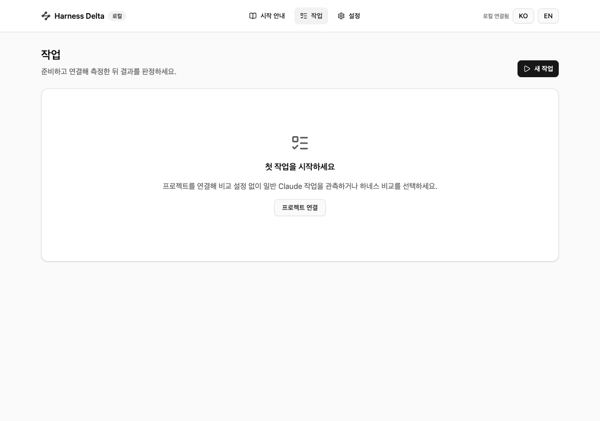

상단 **시작 안내**에는 전체 흐름이 요약되어 있습니다. 위쪽 "일반 Claude 작업 · A/B
배정 없음" 카드가 이 문서의 경로입니다. 아래의 1~6단계 비교 흐름은 A/B 하네스
비교용이므로 지금은 건너뛰어도 됩니다. 오른쪽 위 **KO / EN**으로 언어를 바꿀 수
있습니다.

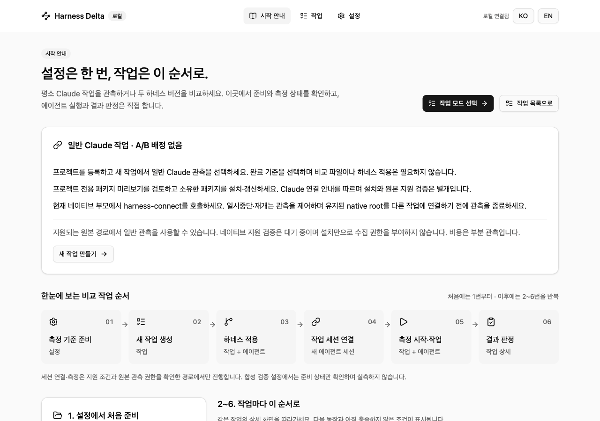

## 1단계: 프로젝트 등록 (처음 한 번)

**설정 → 1. 프로젝트 등록·선택**에서 대상 저장소의 **절대 경로**를 입력하거나
**선택** 버튼으로 디렉토리를 고른 뒤 **프로젝트 연결**을 누릅니다.

```text
/Users/<you>/DEV/project/dnd-15th-2-backend
```

`~/...` 형식은 확장되지 않아 `local_operation_failed`로 실패합니다. 등록은 Git
HEAD만 읽으며 대상 저장소에 파일을 쓰거나 커밋하지 않습니다.

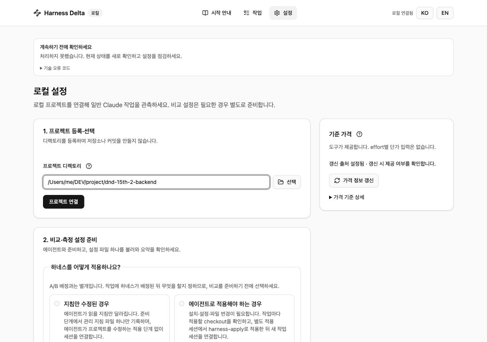

등록하면 "프로젝트를 연결했습니다" 알림과 함께 프로젝트 카드
(`dnd-15th-2-backend`)가 나타납니다. 그 아래 **2. 비교·측정 설정 준비**는 A/B 비교
전용이므로 일반 관측에서는 쓰지 않습니다.

Codex 설정·비교 파일 검토·설정 묶음 불러오기·확정·저장된 설정 재사용까지의
클릭 흐름은 [설정 화면 스크린샷](../runbooks/local-browser-ui.ko.md#설정-화면을-클릭하며-따라가기)을
참고하세요.

## 2단계: Claude 연결 설치 (처음 한 번)

프로젝트 카드 아래 **에이전트 연결 설정**에서 **Claude Code**를 고릅니다.

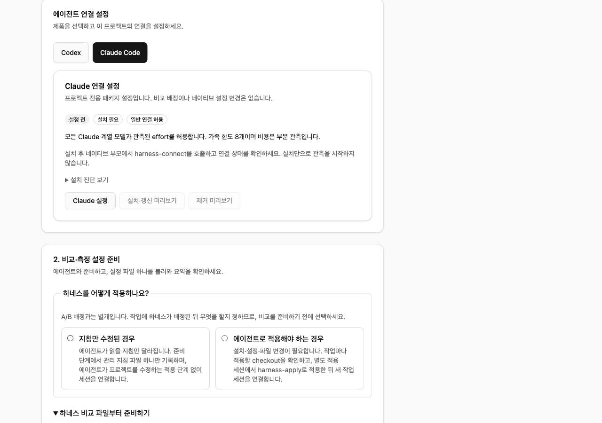

1. **Claude 설정**을 누릅니다. 배지가 `설정 전` → `설정됨`으로 바뀝니다.
   이 단계를 마치기 전에는 4단계의 **측정 준비** 버튼이 비활성화됩니다.
2. **설치·갱신 미리보기**를 누릅니다. 이 단계는 파일을 쓰지 않습니다. 설치될 파일이
   모두 `.claude/skills/harness-connect/` 아래인지 확인합니다.
3. 목록을 검토한 뒤 **검토한 패키지 설치·갱신**을 누릅니다.

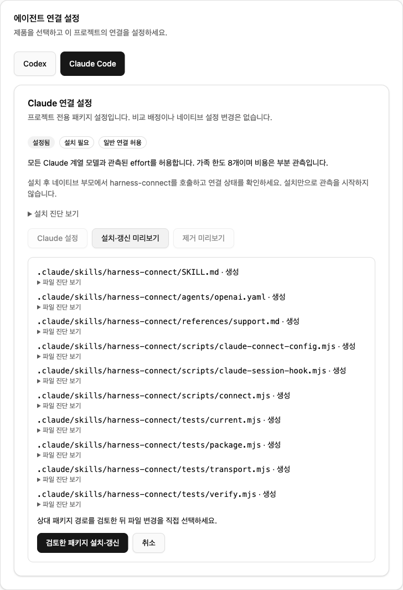

설치가 끝나면 배지가 `설치됨`으로 바뀝니다.

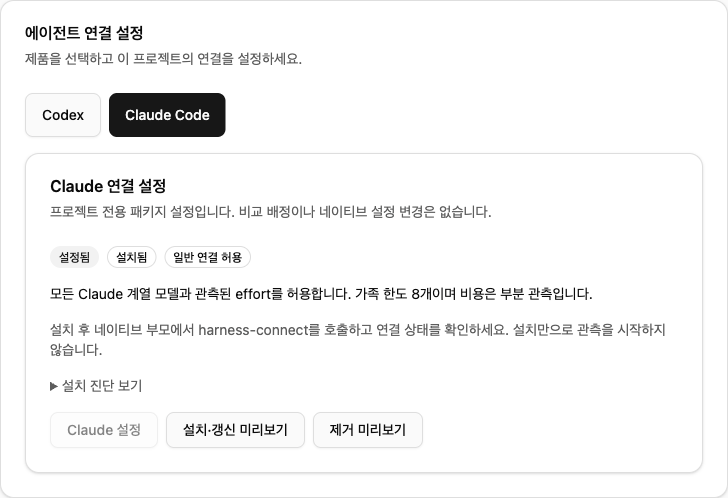

Qello 백엔드의 `.gitignore`는
[대상 저장소 Git에서 로컬 제품 파일 제외](../runbooks/harness-config.ko.md#8-대상-저장소-git에서-로컬-제품-파일-제외)의
로컬 제품 경로를 이미 제외합니다(#357). 이 저장소는 자신의 `/harness-config/`와
`/docs/harness/harness-delta/` 복사본도 무시합니다. 작업과 worktree마다 task id가
다르므로 `check-staged`는 공유 Git hook에 넣지 않습니다. 그래서 설치한
패키지와 연결 기록이 `git add -A`나 `./harness start`·`sync`의 clean worktree 검사에
섞이지 않습니다.

> 설치만으로는 관측이 시작되지 않습니다. 패키지 설치, hook 등록, 연결 확인,
> 측정 중은 서로 다른 상태입니다.

## 3단계: 대상 저장소에서 작업 브랜치 준비

Qello 백엔드의 평소 절차대로 Issue 기반 브랜치와 `TASK.md`를 먼저 만듭니다.
이 단계는 Harness Delta와 무관하며 Qello 하네스 규칙을 따릅니다.

```sh
cd /Users/<you>/DEV/project/dnd-15th-2-backend
./harness start --issue <issue-number> --type feat --slug notification-inbox-read
./harness task-init --title "알림함 읽기 API (F07-N1)" --replace
```

## 4단계: 새 작업 만들기

Harness Delta UI에서 **작업 → 새 작업**을 엽니다.

| 입력 | 값 |
| --- | --- |
| 작업 모드 | **일반 Claude 관측 · 비교 설정 불필요** |
| 작업명 | `알림함 읽기 API (F07-N1)` (Issue 제목과 맞추면 나중에 찾기 쉽습니다) |
| 프로젝트 | `dnd-15th-2-backend` |
| 완료 기준 | "사용자가 원래 요청의 완료를 직접 확인" (기본 선택) |
| 선택 항목 | 유형 `feature`, 크기 `small` 등. 필요할 때만 바꿉니다. |

**측정 준비**를 누르면 작업이 만들어지고 상세 화면으로 이동합니다. 작업은 이
시점의 프로젝트 설정과 가격표를 고정합니다.

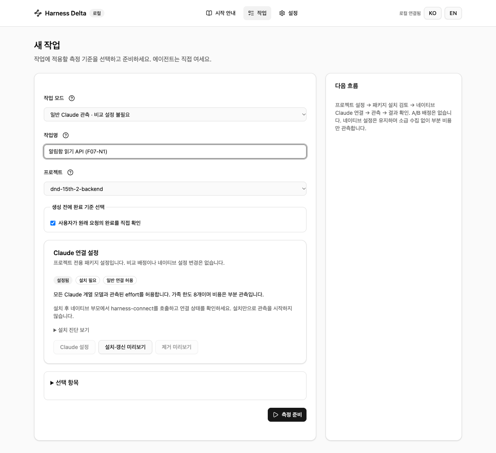

Claude 설정만 하고 설치를 건너뛰었다면 상세 화면에 "이 프로젝트에 연결 도구가 필요합니다."가
표시됩니다. 같은 화면의 **설치·갱신 미리보기**로 설치를 마치면 다음 단계로 넘어갑니다.

Codex 작업은 이 배정 없는 Claude 관측 흐름이 아닙니다. Codex에는 별도의 고정
`functional_pilot` 배정 워크플로가 필요합니다.

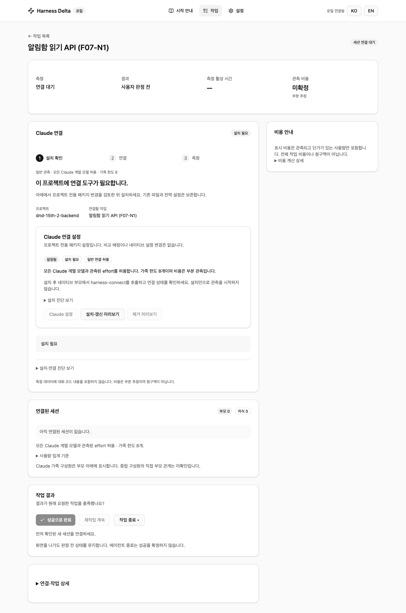

## 5단계: Claude 세션 연결

설치가 확인되면 상세 화면의 **Claude 연결** 카드가 `2 연결` 단계로 바뀌고 호출
문구를 보여 줍니다.

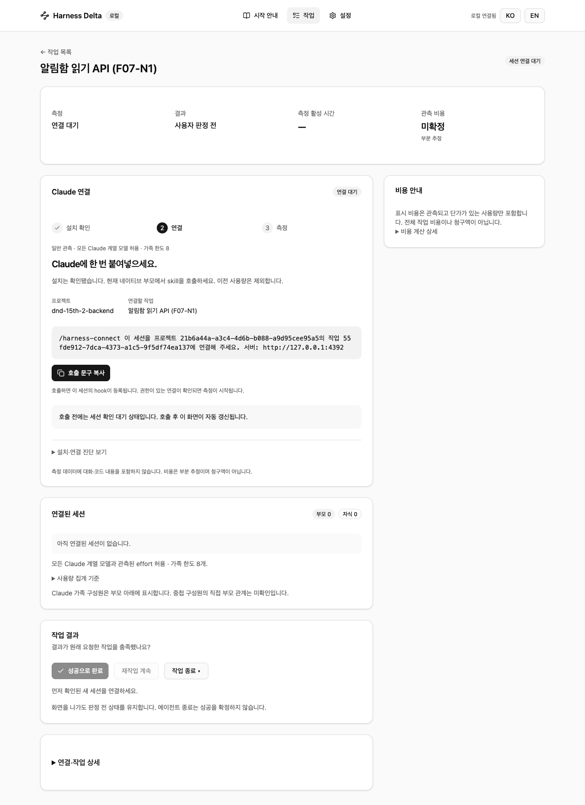

1. 터미널에서 대상 저장소로 이동해 Claude를 직접 엽니다.

   ```sh
   cd /Users/<you>/DEV/project/dnd-15th-2-backend
   claude
   ```

2. UI에서 **호출 문구 복사**를 누르고, 방금 연 Claude 세션(부모)에 **한 번**
   붙여넣습니다. 문구 형식은 다음과 같습니다.

   ```text
   /harness-connect Connect this session to project <PROJECT_ID>, task <TASK_ID>, using http://127.0.0.1:4318.
   ```

3. UI 화면이 자동으로 갱신될 때까지 기다립니다. 연결되면 "연결됐습니다. 작업을
   시작하세요."가 표시되고 단계가 `3 측정`으로 바뀝니다.

연결 전 사용량은 제외됩니다. 이미 오래 쓰던 세션을 연결해도 연결 이후의 사용량만
집계합니다.

## 6단계: 측정 중 확인 후 평소처럼 작업

상태가 **측정 중**인지 확인한 다음 Claude에게 작업을 요청합니다. 아직 사용량이
없으면 "측정 중 · 첫 사용량을 기다리는 중입니다."가 표시되고, 비용은 0이 아닌
**미확정**으로 남습니다.

이 세션이 하위 에이전트(자식)를 띄우면 **연결된 세션** 표에 부모 아래로 함께
집계됩니다. 표의 에이전트·모델 열은 관측된 메타데이터로 채워집니다.

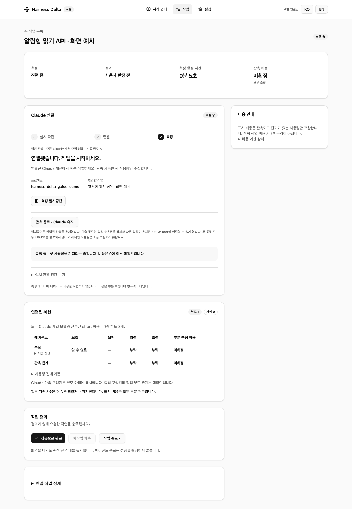

화면 위에서 아래로 다음을 확인합니다.

1. 상단 요약의 측정은 **진행 중**, **Claude 연결** 배지는 **측정 중**입니다.
   수집 상태를 뜻하며 작업 성공을 뜻하지 않습니다.
2. 연결 카드에 "연결됐습니다. 작업을 시작하세요."가 나오고 `3 측정`이 강조됩니다.
3. **연결된 세션**은 부모 1, 자식 0입니다. 사용량 도착 전에는 모델은 알 수 없음,
   요청은 `—`, 입력·출력은 누락, 비용은 미확정입니다. 연결만으로 관측된 0이 되지 않습니다.

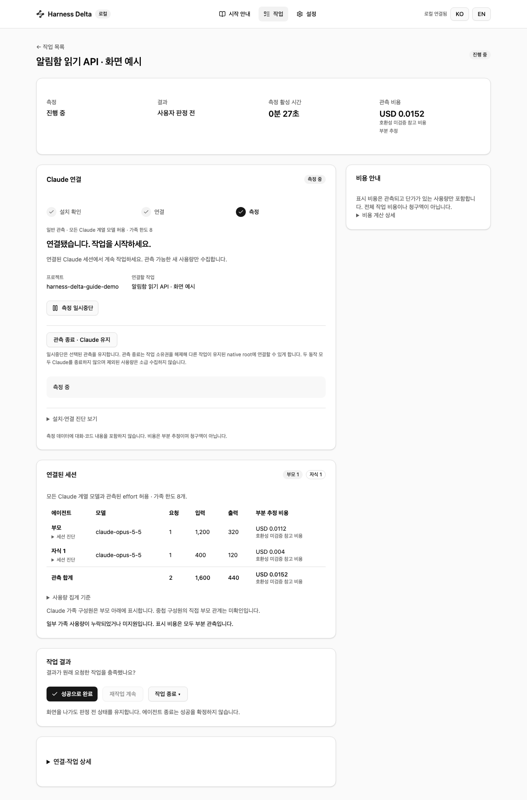

예시에서 부모는 요청 1건·입력 1,200·출력 320 토큰, 자식은 요청 1건·입력 400·출력
120 토큰입니다. **관측 합계**는 요청 2건·입력 1,600·출력 440 토큰이며 합계 행을
다시 더하지 않습니다. USD 0.0152는 **호환성 미검증 참고 비용**으로 표시된 예시의
부분 추정액입니다. 청구액이나 검증된 전체 비용이 아닙니다. 숫자가 있어도 가족 사용량
누락 경고를 확인하세요. 가족 구성원은 루트 아래에 표시되며, 중첩 구성원의 직접 부모
관계를 확인한 표는 아닙니다.
이 예시의 미검증 표시는 현재 Claude 연결 경로의 qualification 미완료에서 온 것이며,
업데이트 대상인 새 버전을 사용했다는 뜻은 아닙니다.

Qello 백엔드 작업에서는 평소처럼 Claude가 테스트와 검증을 수행합니다.

```sh
./harness check
./harness pr-ready --project-tests
```

작업 중 쓸 수 있는 버튼은 다음과 같습니다.

| 버튼 | 하는 일 | 하지 않는 일 |
| --- | --- | --- |
| **측정 일시중단** | 수집을 멈춥니다. 회의·다른 작업 중에 씁니다. | Claude를 멈추지 않습니다. 멈춘 구간을 나중에 채우지 않습니다. |
| **측정 재개** | 새 기준점부터 다시 수집합니다. | 일시중단 구간을 소급 수집하지 않습니다. |
| **관측 종료 · Claude 유지** | 이 작업의 세션 소유권을 풉니다. | Claude를 종료하지 않습니다. |

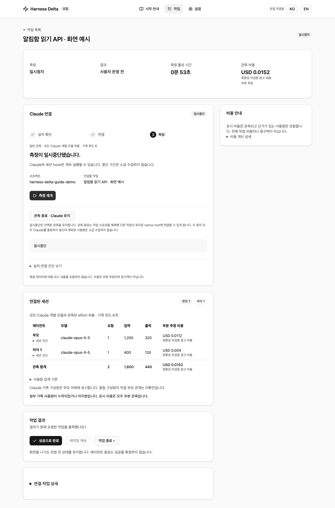

**측정 일시중단**을 누르면 상단 요약은 **일시정지**, 연결 카드는 **일시중단**으로
바뀌고 버튼은 **측정 재개**가 됩니다. 기존 세션 행과 부분 비용은 남아 있지만 새로
수집 중이라는 뜻은 아닙니다. **측정 재개**를 누르면 이후 사용량부터 다시 관측합니다.
세션을 재개할 수 없다면 화면의 연결 안내를 따르세요.

## 7단계: 관측 종료와 결과 판정

작업이 끝나면(예: PR 준비 완료) 순서대로 진행합니다.

1. **관측 종료 · Claude 유지**를 누릅니다. 같은 Claude 세션으로 다음 작업을 이어서
   하려면 이 단계가 필요합니다. 종료 전에 다른 작업에 연결하면
   `binding_session_conflict` 또는 `binding_receipt_stale`이 반환됩니다.
2. 남아 있는 사용량을 검토하고 **작업 결과**에서 직접 판정합니다.

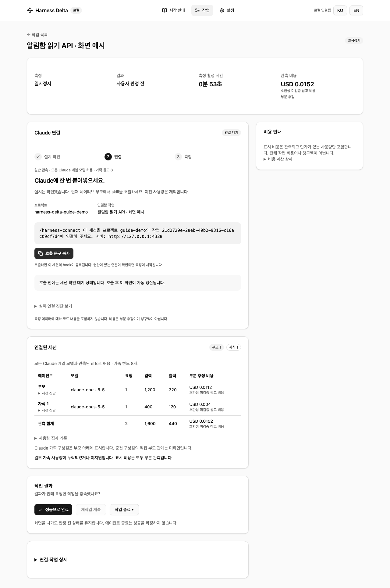

관측 종료와 작업 완료는 별개입니다. 현재 UI에서는 관측 종료 후 연결 카드가
**연결 대기**로 돌아오고, 상단 요약은 여전히 **일시정지**·**사용자 판정 전**일 수
있습니다. 기존 세션 행과 비용도 남습니다. 성공 판정이 된 상태가 아니며, 작업을
완료하려고 이전 연결 문구를 다시 붙여넣을 필요는 없습니다.

| 판정 | 언제 |
| --- | --- |
| **성공으로 완료** | 원래 요청(Issue의 완료 조건)을 충족했을 때. 최종 확정입니다. |
| **재작업 계속** | 여기서 보여 주는 일반 관측에서는 비활성화되어 있습니다. 수정이 필요하면 성공을 확정하지 마세요. |
| **작업 종료 ▾ → 실패로 종료 / 포기** | 요청을 달성하지 못했거나 중단할 때. |

요구사항이 추가됐다면 재작업이 아니라 새 작업을 만드세요. 화면을 나가거나 Claude를
종료해도 성공은 자동으로 기록되지 않습니다.

원래 완료 기준을 검토한 뒤 **성공으로 완료**를 누릅니다. 확인 창이 열리고,
**취소**하면 판정 전 상태로 남습니다.

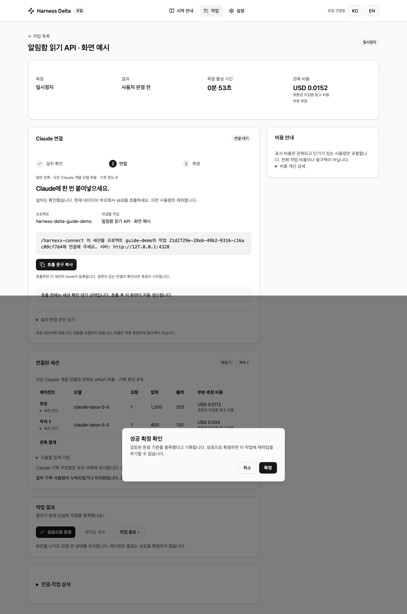

**확정**을 눌러야 최종 결과가 기록됩니다. 확인 창의 안내처럼 성공으로 확정한
작업에는 재작업을 추가할 수 없습니다.

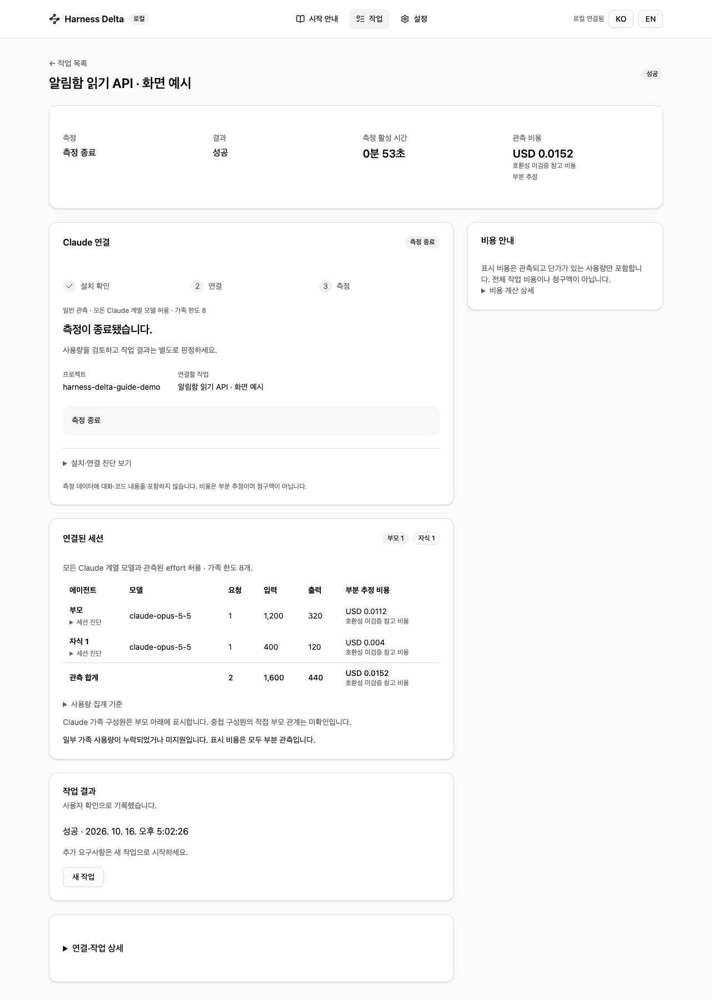

상단 요약이 **측정 종료**·**성공**으로 바뀌고, **작업 결과**에 사용자가 확정한 결과와
시각이 기록됩니다. 세션 행과 부분 추정액은 검토용으로 남습니다. 성공 판정이 사용량을
완전하게 만들거나 비용을 청구액으로 바꾸지는 않습니다.

## 다음 작업으로 넘어가기

같은 Claude 세션을 계속 쓴다면 다음과 같이 반복합니다.

1. 이전 작업에서 **관측 종료 · Claude 유지**를 했는지 확인합니다.
2. 대상 저장소에서 다음 Issue 브랜치를 준비합니다(3단계).
3. UI에서 새 작업을 만들고(4단계), 새 작업의 호출 문구를 같은 세션에 붙여넣습니다(5단계).

새 작업은 새 기준점과 자체 측정 ID로 시작하며 이전 작업의 사용량을 옮겨 오지
않습니다. Claude를 다시 실행했다면 같은 세션 ID를 재개해도 호출 문구를 다시
붙여넣어야 합니다.

## 결과 읽는 법

상세 화면 상단 요약은 네 가지를 보여 줍니다.

| 항목 | 의미 |
| --- | --- |
| 측정 | 상단 요약: 연결 대기 / 진행 중 / 일시정지 / 측정 종료. 연결 카드는 측정 중 / 일시중단으로 표시합니다. |
| 결과 | 사용자 판정 전 또는 판정 결과 |
| 측정 활성 시간 | 수집이 켜져 있던 시간입니다. 사람이 일한 시간이 아닙니다. |
| 관측 비용 | 관측되고 단가가 있는 사용량만 합한 부분 추정입니다. 빠진 단가는 0이 아닌 미확정입니다. |

비용 계산 방식은 [관측 비용](../runbooks/observed-cost.ko.md)과
[기준 가격](../runbooks/reference-price-catalog.ko.md)을 참고하세요.

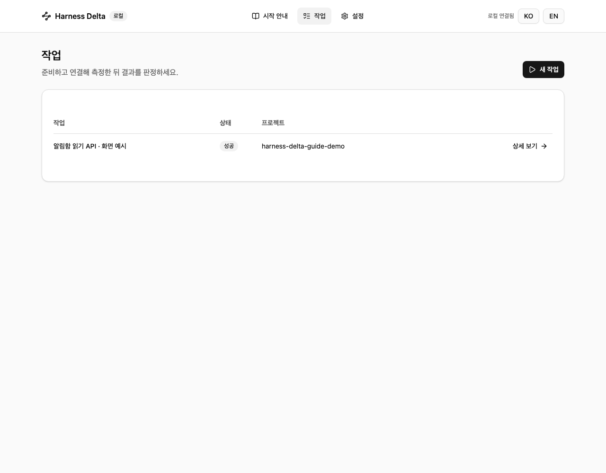

**작업 목록**으로 돌아가면 작업명·**성공**·예시 프로젝트가 표시됩니다.
**상세 보기**는 보관된 결과를 다시 열고, **새 작업**은 별도 측정을 시작합니다.
확정된 작업에 시도를 추가하는 버튼이 아닙니다.

## 자주 막히는 지점

| 증상 | 원인 | 조치 |
| --- | --- | --- |
| 프로젝트 연결 시 `local_operation_failed` | `~` 경로 등 해석할 수 없는 경로 | 절대 경로를 입력하거나 **선택** 버튼을 씁니다. |
| 연결 시 `claude_source_version_unsupported` | Claude Code가 프로젝트에 설정된 버전(새 설정은 2.1.306)이 아님 | 설정된 버전으로 Claude Code를 실행합니다. |
| 다른 작업 연결 시 `binding_session_conflict` | 같은 세션이 이전 작업에 아직 묶여 있음 | 이전 작업에서 **관측 종료 · Claude 유지**를 누릅니다. |
| 설치 시 `package_unowned`, `package_drift` | `.claude/skills/harness-connect`를 손으로 수정했거나 다른 도구가 만든 파일이 있음 | 해당 파일을 백업·검토한 뒤 다시 미리보기합니다. 덮어쓰지 않습니다. |
| 설치 해제 시 `ordinary_installation_in_use` | 진행 중인 일반 작업이 있음 | 작업을 먼저 종료·판정합니다. |
| 서비스 재시작 후 수집이 멈춤 | 재시작 시 작업은 일시중단 상태로 남음 | 작업 화면에서 재개하거나, Claude를 다시 실행했다면 호출 문구를 다시 붙여넣습니다. |

## 지키는 경계

- 측정 데이터에는 프롬프트·응답·소스 코드·비밀값이 들어가지 않습니다.
- 등록된 프로젝트, 진행 중인 작업, 연결된 세션의 사용량만 수집합니다.
- 일시중단·오프라인·연결 전 사용량은 미관측으로 남기며 소급하지 않습니다.
- UI는 Claude를 실행·종료하지 않고, 커밋·인증 변경·외부 공개를 하지 않습니다.
