# 로컬 브라우저 작업 흐름

[English](local-browser-ui.md)

Node.js 24 또는 26과 비공개 `hm` 체크아웃을 사용하세요. UI는 CLI와 같은 Store 및
외부 작업 coordinator를 사용합니다. 일반 측정 흐름은 에이전트를 실행하지 않습니다.
Format-2 적용에서는 새 macOS Terminal 세션 열기를 명시적으로 요청할 수 있습니다.
`open_requested`는 에이전트 시작의 증거가 아니며 native acceptance는 미검증입니다.
UI는 인증 변경, 커밋 생성, 서비스 외부 공개를 하지 않습니다.

## 로컬 서비스 시작

체크아웃에서 실행하세요.

```sh
npm ci
npm run build
npm start -- --db local.sqlite ui
```

메인 CLI 등록 후에는 같은 동작을 다음 명령으로 실행합니다.

```sh
hm --db local.sqlite ui
```

표시된 `http://127.0.0.1:4318` 주소를 여세요. `--port`는 로컬 포트만 바꾸며
호스트 옵션은 없습니다. Ctrl+C로 로컬 서비스를 중단하세요. 관측기 종료를
확인하고 활성 측정을 일시중단하며, 외부 AI는 사용자가 제어합니다.

설치 전에 Node 24 또는 26을 선택하고 `node --version`을 확인하세요. Node major를
바꿨다면 `npm ci`를 다시 실행해 선택한 runtime에 맞게 SQLite를 빌드하세요. 진입점은 SQLite를
import하기 전에 `unsupported_node`(exit 2), `build_required`(exit 3),
`dependencies_required`(exit 4)를 구분합니다. 체크아웃에서 표시된 안내를 따르세요.
AI 제품을 설치하거나 전역 runtime을 바꾸지는 않습니다.

빈 UI를 여는 데 설정 파일은 필요하지 않습니다. 일반 Claude 관측은 **설정**에서
프로젝트를 등록하고 Claude 연결을 설정한 뒤, 프로젝트 패키지를 미리보기·설치하세요.
**새 작업**에서 **일반 Claude 관측**을 선택하고 이름·프로젝트·완료 기준을 지정하세요.
비교·protocol·A/B 배정은 필요하지 않습니다.
[일반 연결 절차](harness-connect.ko.md#일반-claude-관측-지원-검증-대기)를 따르세요.
아래 비교 설정은 선택 사항이며 배정된 A/B 작업에 적용됩니다.
검토한 비교를 시작할 때 불러오려면 `--setup reviewed-ui-setup.json`을 추가하세요.

## 설정 화면을 클릭하며 따라가기

아래 한국어 UI 화면은 2026-10-16에 실제 로컬 서버와 빌드된 UI에서 캡처했습니다.
프로젝트 경로·식별자·비교 입력·단가는 격리된 예시입니다. 네이티브 에이전트를
실행하거나 연결하지 않았습니다. 비교는 실측이 아닌 **합성 검증**입니다.
2099년 모집 날짜·참가자·완료 기준·표본 수·단가는 권장값이 아니며, 본인이 검토한
값을 사용하세요. 상단 **EN**으로 영어 화면을 볼 수 있습니다.

일반 Claude 관측은 아래 프로젝트 등록과 Claude 설정까지만 한 뒤
[작업 따라 하기](../guide/walkthrough.ko.md#4단계-새-작업-만들기)로 이동하세요.
비교 설정은 선택 사항이며 일반 Claude 작업을 위해 A/B 비교를 만들 필요는 없습니다.

### 프로젝트 등록과 선택

1. **설정**을 누릅니다. 등록된 프로젝트가 없으면 필요한 입력을 채우기 전까지
   **프로젝트 연결**과 비교 준비 동작이 비활성화됩니다.

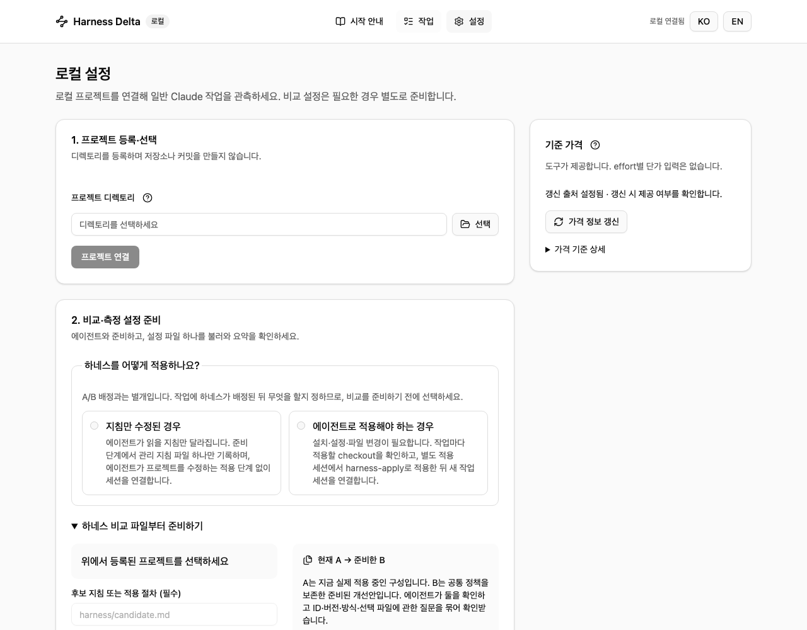

2. Git 프로젝트의 절대 경로를 입력하거나 **선택**으로 고른 뒤
   **프로젝트 연결**을 누릅니다. 예시 경로는 일회용이므로 본인 환경에
   붙여넣지 마세요. 등록은 세션 내용이 아닌 HEAD를 읽습니다.

3. 연결하면 해당 프로젝트가 선택되고 **에이전트 연결 설정**이 나타납니다.
   선택한 프로젝트에 따라 에이전트 설정과 저장된 비교 목록이 달라집니다.

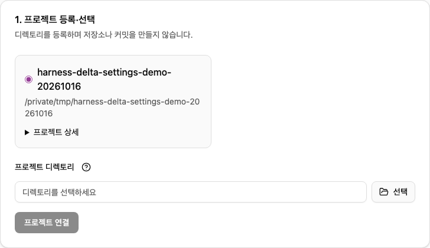

### Claude 설정과 설치 미리보기

**Claude Code**를 선택하고 **Claude 설정**을 누릅니다. **설정됨**과 **설치됨**은
다른 배지입니다. **설치·갱신 미리보기**를 누르면 파일을 쓰지 않고 상대 경로와
변경 동작을 보여 줍니다.

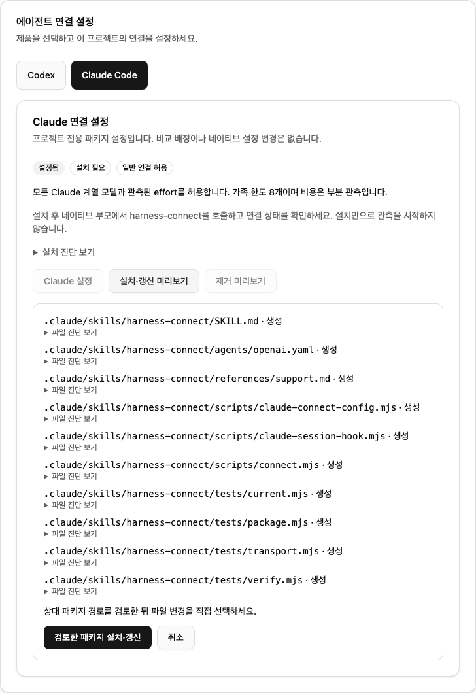

`.claude/skills/harness-connect/` 아래 경로를 검토한 뒤 **검토한 패키지 설치·갱신**을
누르면 **설치됨**으로 바뀝니다. **취소**는 적용 없이 미리보기를 닫습니다.
**제거 미리보기**는 별도 제거 동작이며 측정을 멈추는 버튼이 아닙니다.

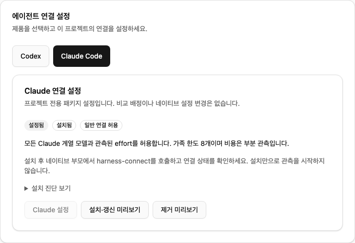

설치만으로 세션 연결이나 수집이 시작되지는 않습니다. 이후 일반 작업을 만들고
Claude에서 그 작업의 호출 문구를 실행하세요. 이 화면에 도달해도
[현재 원본·바이너리 지원 조건](harness-connect.ko.md#현재-구현)은 그대로 적용됩니다.

### Codex 설정 상태 구분

**Codex**를 눌러 제품을 전환합니다. 설정 전 예시는 **설정 전**·`파일: absent`·
**Hook 신뢰: 미확인**·**연결된 루트: 0**입니다. **Codex 설정**을 누르면 표시된
버전과 허용 소스 루트를 저장합니다.

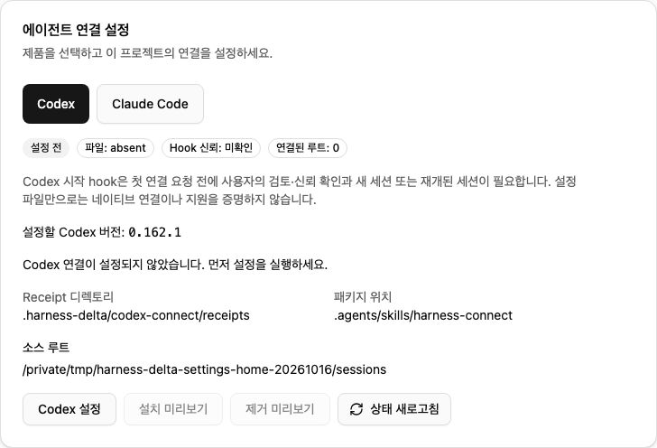

**설치 미리보기**를 누릅니다. 스킬 패키지·recorder·프로젝트 hook 파일·receipt
디렉토리를 검토한 뒤 **검토한 패키지 설치**를 누릅니다.

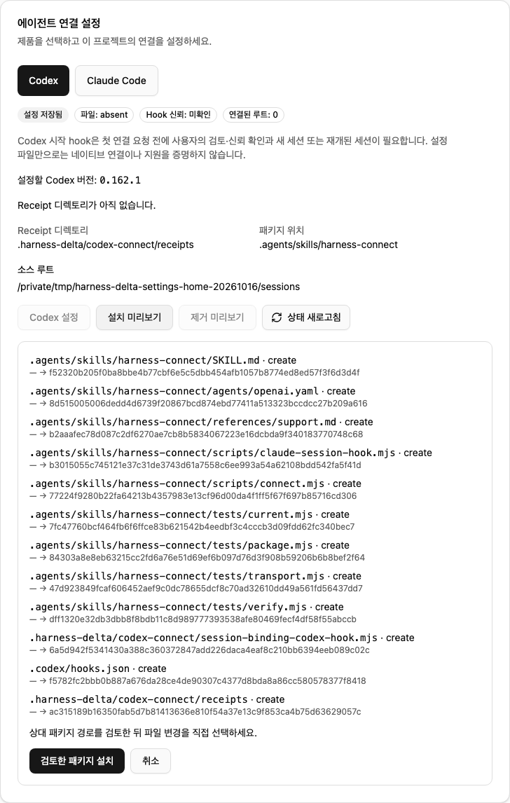

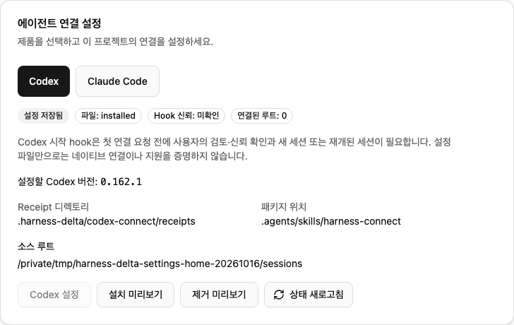

`파일: installed`여도 **Hook 신뢰: 미확인**과 **연결된 루트: 0**은 그대로입니다.
네이티브 hook 신뢰를 확인하고 Codex를 새로 시작하거나 재개한 뒤 작업을 연결하세요.
**상태 새로고침**은 설정을 다시 읽을 뿐 세션을 연결하지 않습니다. Codex에는
배정 없는 일반 Claude 모드가 아닌 별도 배정 경로가 필요합니다.
[Codex 0.162.1 제한 일반 profile](harness-connect.ko.md#codex-01621-제한-일반-profile) 또는
명시적으로 선택한 [Codex 0.163.0 제한 일반 profile](harness-connect.ko.md#codex-01630-제한-일반-profile)입니다.
버전 선택기에는 둘 다 있으며, 저장된 설정은 저장된 버전을 유지합니다.

### 비교 파일 준비와 확인

A/B 작업일 때만 이어갑니다. **2. 비교·측정 설정 준비**에서 하네스 적용 방식을
고릅니다. **지침만 수정된 경우**는 선택 지침을 전달하고, **에이전트로 적용해야 하는
경우**는 별도 적용 절차가 필요합니다. A/B 중 어느 쪽을 배정할지 고르는 항목이 아닙니다.

준비된 후보의 프로젝트 상대경로와 필요한 참고 파일·README 원본을 입력합니다.
**에이전트 요청문 복사**를 누르고, 에이전트가 제안한 등록 입력을 검토한 뒤 비교
파일을 만드세요. 클립보드 복사가 실패하면 직접 복사할 문구가 표시됩니다.
복사만으로 에이전트를 실행하지 않습니다.

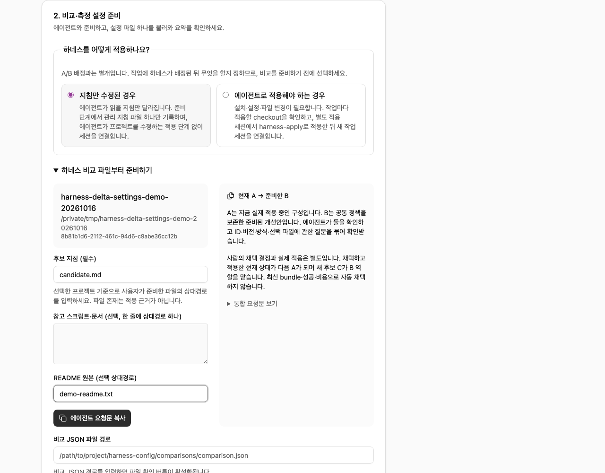

전달받은 비교 JSON의 절대경로를 입력하고 **비교 파일 확인**을 누릅니다.
**비교 파일 확인됨 · 아직 저장 전**에 순서가 있는 A/B 쌍을 보여 주고, 아래에
측정 설정 준비 요청문과 미결정 항목을 표시합니다. 파일 확인은 설정 저장이나
B의 실제 적용 확인이 아닙니다.

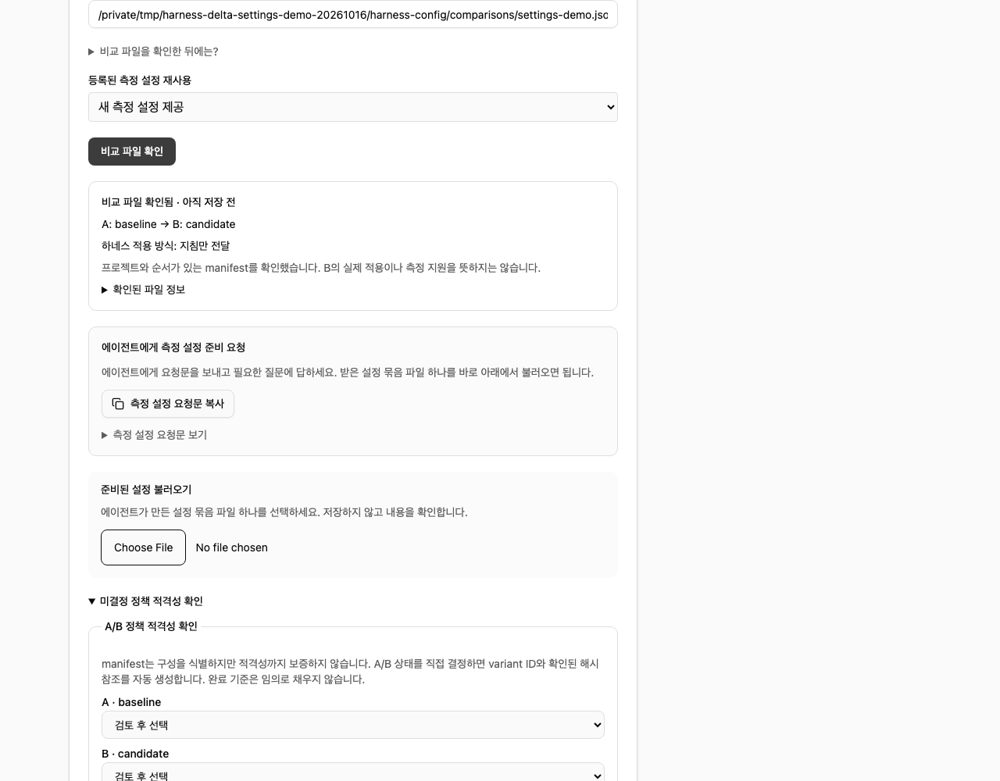

### 설정 묶음 불러오기와 조건 검토

**측정 설정 요청문 복사**로 아직 필요한 결정을 에이전트와 검토합니다.
**준비된 설정 불러오기**에서 에이전트가 만든 설정 묶음 하나를 선택하세요.
**기존 설정 파일이 있나요?** 아래의 UI manifest 가져오기와 다른 입력입니다.
비교 descriptor 하나만으로 측정 설정 묶음이 되지는 않습니다.

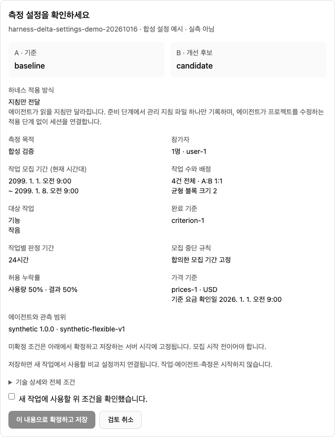

프로젝트·A/B 순서·적용 방식·목적·참가자·모집 날짜·표본 규칙·대상 작업·완료 기준·
추적 기간·누락률·가격·원본 범위를 확인합니다. **기술 상세와 전체 조건**을 펼치면
전체 입력을 볼 수 있습니다. 예시 화면의 목적은 **합성 검증**입니다.

선택한 적용 방식이 파일과 다르면 경고가 나옵니다. 묶음을 불러와도 적용 방식을
대신 선택하지 않습니다. 일치하는 방식을 선택하거나 새로 검토한 비교를 준비하세요.
경고를 우회하려고 방식만 바꾸지 말고, 바뀐 입력은 저장 전에 다시 검토하세요.

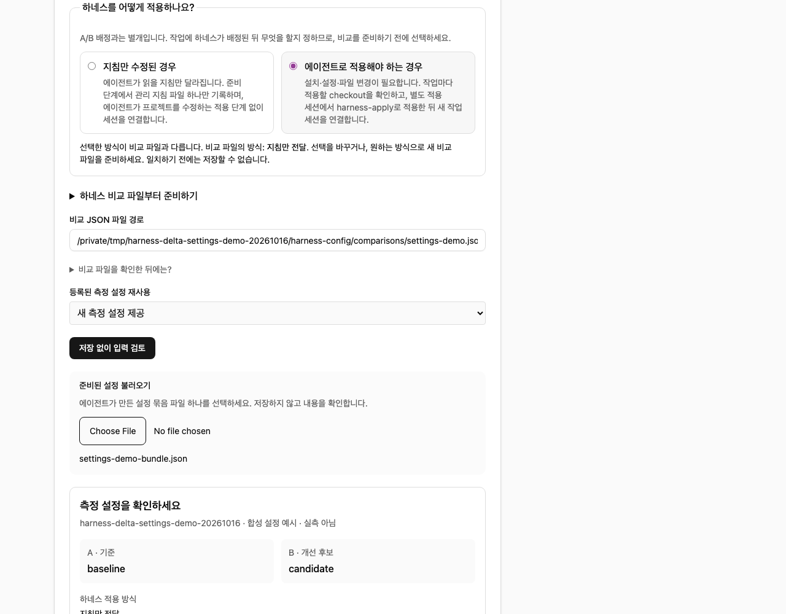

### 확정·저장과 재사용

검토한 뒤 **새 작업에 사용할 위 조건을 확인했습니다.**를 체크합니다.
확인 체크와 적용 방식이 모두 맞으면 **이 내용으로 확정하고 저장**을 누를 수
있습니다. 한 번 눌러 저장하세요. 검토만으로는 저장되지 않습니다.

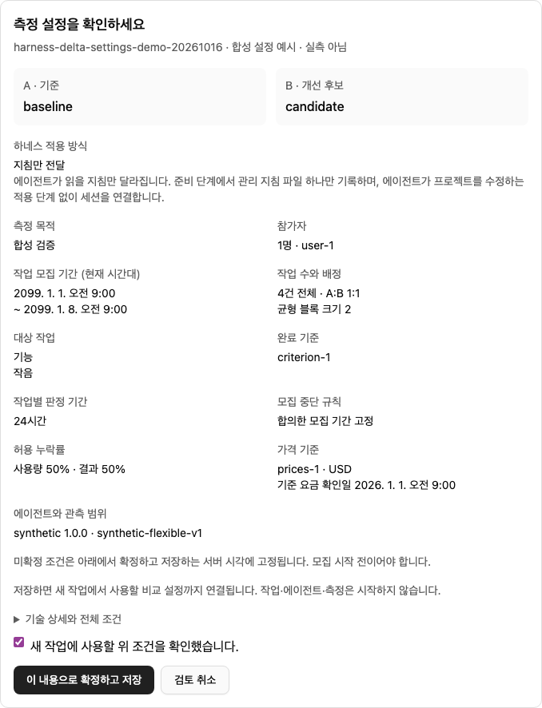

**저장된 비교·측정 설정**에 비교가 나타납니다. **저장된 조건 확인**을 펼치면
작업 유형과 크기를 볼 수 있습니다. 저장 카드는 검토 화면의 이름(`baseline` /
`candidate`) 대신 variant ID(`variant-a` / `variant-b`)로 같은 A/B 쌍을 표시합니다.
다음 작업에서도 재사용하므로 매번 다시
불러오지 마세요. 저장만으로 작업·에이전트·측정은 시작하지 않습니다.

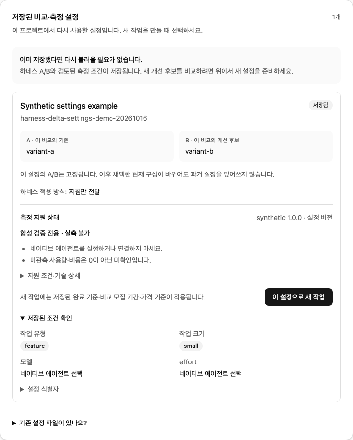

**이 설정으로 새 작업**을 누르면 비교 모드·프로젝트·설정이 선택된 폼이 열립니다.
예시는 의도적으로 2099년 날짜를 사용해서 **아직 작업 모집이 시작되지 않았습니다**가
나오며 작업 준비가 차단됩니다. 연결 실패가 아니며 예시 날짜를 복사해서 해결할
문제도 아닙니다.

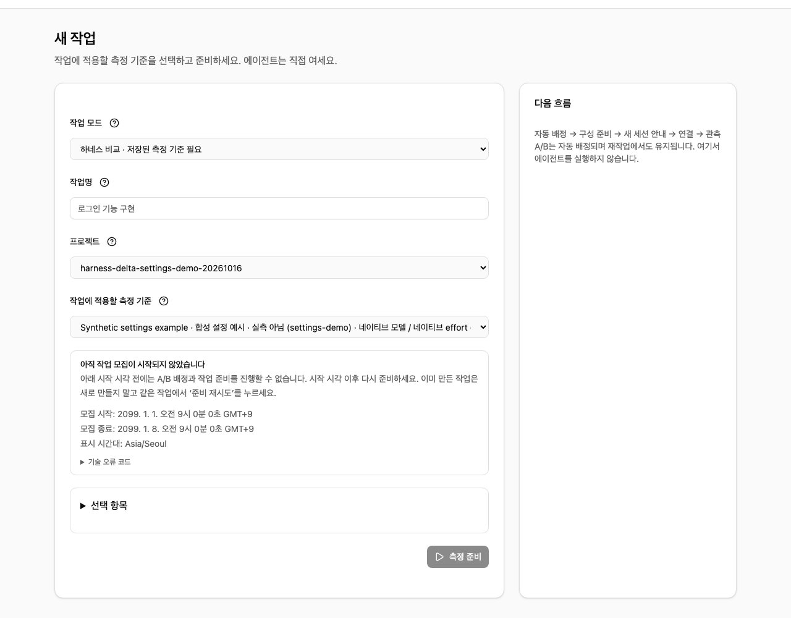

### 가격 기준 상세 확인

오른쪽 **가격 기준 상세**를 펼치면 캐시된 카탈로그 버전과 제공자 가격 확인일을
볼 수 있습니다. **가격 정보 갱신**은 온라인 갱신을 시도하는 별도 동작이며 새 가격표가
있음을 보장하지 않습니다. 이 캡처에서는 상세만 펼쳤고 가격 갱신은 실행하지
않았습니다. 기존 작업의 가격 고정값은 교체되지 않습니다.

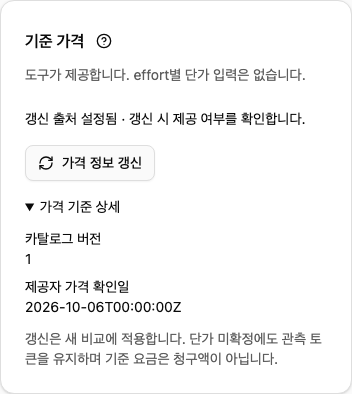

## 로컬 삭제와 비공개 메타데이터

CLI의 작업·프로젝트 삭제와 보존 기간 정리는 등록된 비공개 UI 작업·원본
기록과 응답 캐시도 제거합니다. 사용된 동작 키는 계속 차단하므로 이전 요청을
재시도해도 삭제한 작업을 다시 만들지 않습니다. 측정 데이터 삭제가 커밋된 뒤
영속 정리 기록으로 후속 삭제를 수행하며, 두 데이터베이스 파일을 하나의
원자적 트랜잭션으로 처리하지는 않습니다. `ui_metadata_cleanup_pending`은
삭제 권한 처리는 커밋됐지만 비공개 데이터 정리가 끝나지 않았다는 뜻입니다.
동일한 메타데이터 파일에 대한 접근을 복구하고 명령을 다시 실행하세요.
Store 시작 시에도 미완료 정리를 재시도하며 교체되었거나 안전하지 않은 파일은 수정하지 않습니다.

UI를 열면 사용자 지정 `--metadata` 경로를 포함한 메타데이터 파일을 등록합니다.
업그레이드 후에는 이전에 사용한 각 사용자 지정 UI 메타데이터 파일을 한 번
열고 나서 CLI 삭제에 해당 파일의 정리까지 맡기세요. 아직 열지 않아 등록되지
않은 기존 사용자 지정 파일은 CLI가 발견할 수 없습니다. 해당 파일을 열 때
기존 tombstone을 반영한 뒤 비공개 기록을 노출합니다. 이미 내보낸 파일과
네이티브 대화 기록은 로컬 작업 삭제 범위에 포함되지 않습니다.

## 작업에 적용할 측정 기준

**설정**에서 프로젝트 디렉토리를 선택하세요. 등록은 Git HEAD를 읽으며
저장소나 커밋을 만들지 않습니다. 새 작업 준비 시 코드 기준을 다시 읽습니다.
미커밋 변경은 보존합니다. HEAD는 커밋된 기준이며 미커밋 파일의 스냅샷은 아닙니다.

프로젝트에 이미 저장된 설정이 있다면 **이 설정으로 새 작업**을 선택하세요.
해당 프로젝트와 설정이 선택된 새 작업 화면이 열립니다. 아직 저장하지 않은
검토된 파일은 **기존 설정 파일이 있나요?**를 펼쳐
**기존 설정 파일 불러오기**를 선택하거나 `--setup`으로 연결하세요. 비공개
manifest는 `schema_version: 1`과 `profiles`를 가지며 각 항목은 `id`, `name`,
`setup`, `execution`을 포함합니다. `setup`은 공용 `ExternalTaskSetupSchema`를
사용합니다. `execution`은 검토한 바이너리, Codex home, recorder, sandbox,
timeout, poll interval을 포함합니다. 세션 ID와 원본 경로는 미리 지정하지
않고 나중에 선택합니다. 원본 계약은 [외부 작업 흐름](external-session-workflow.ko.md)을
참조하세요.

템플릿은 등록 프로젝트, 동결한 schema-2 protocol, 검토된 하네스 쌍 및
고정 완료 기준을 이미 참조해야 합니다. 공용 선택 builder가 이를 확인합니다.
UI는 비교 규칙, 가격, 완료 기준이나 원본 지원 판정을 임의로 만들지 않습니다.
지원하지 않는 유형·크기는 비활성화합니다. 폼은 feature/fix/infra/chore/docs/ci와
small/medium/large를 제공합니다. 모델과 effort는 네이티브 에이전트에서 자유롭게
선택합니다.

**저장된 비교·측정 설정**에는 선택한 프로젝트의 설정만 표시됩니다. 카드에는
각 비교의 고정된 A/B 쌍을 표시하고, 저장된 조건을 펼치면 허용 작업 유형과
크기를 볼 수 있습니다. 이미 저장된 설정을 다시 불러올 필요는 없습니다.
설정이 없으면 위에서 새 비교를 준비하고 검토하세요. 비교 모집 기간은 동결된
protocol의 기간이며 작업별 관측 구간이 아닙니다. 파일을 불러와도 수집 권한이
생기지는 않습니다. 신규 또는 신규·기존 혼합 파일은 **검토된 설정을 연결했습니다.**,
동일 반복은 **이미 연결된 설정입니다.**로 안내합니다. 설정과 작업을 복제하지
않습니다. 같은 ID의 내용이 다르면 파일 전체를 거절하고 기존 설정을 보존합니다.
선택기를 취소하면 설정은 그대로 유지됩니다.

### 설정 파일 작성

skill이 생성한 snapshot은 **2. 에이전트와 준비하세요**에서 연결할 수 있습니다.
모든 입력을 별도 CLI 명령으로 조합·등록할 필요는 없습니다.

하네스를 준비하기 전에 프로젝트부터 연결하세요. 등록한 프로젝트를 선택하고
미리 준비한 후보 지침·적용 절차 파일과 필요한 스크립트·문서의 프로젝트 기준
상대경로를 입력하세요. 복사하는 요청문에는 등록된 디렉터리와 명시한 후보 파일이
들어가므로 ID와 버전을 모두 직접 작성할 필요는 없습니다. 에이전트가 현재 적용된
기준 구성을 확인하고 등록 입력을 제안하며 필요한 선택을 묶어 확인받습니다.
스킬이 없으면 특정 컴퓨터의 경로를 추측하지 않고 도구 checkout 위치를 질문합니다.

A는 현재 적용된 구성이고 B는 공통 규칙을 유지하는 개선 후보입니다.
A/B는 고정 버전 이름이 아닌 비교 역할입니다. 사람이 채택하고 실제 적용한 구성은
다음 비교의 A가 될 수 있습니다. 등록·작업 성공·낮은 부분 비용이 후보를 자동
채택하지 않으며 과거 비교와 배정은 유지합니다.

1. **1. 프로젝트 등록·선택**에서 Git 프로젝트를 연결하고 선택하세요.
   **하네스를 어떻게 적용하나요?**에서 **지침만 수정된 경우** 또는
   **에이전트로 적용해야 하는 경우**를 선택하세요. 이 선택은 A/B 배정과 별개이며,
   배정된 하네스를 지침으로 전달할지 에이전트가 checkout에 적용할지를 정합니다.
   선택 전에는 요청문을 복사할 수 없고, 선택값은 `application_mode`로 에이전트에
   전달됩니다. 이후 단계는 비교 파일에 저장된 방식을 표시하며, 선택과 다르면
   알려주고 저장할 수 없습니다. 설정 묶음을 불러와도 방식을 대신 선택하거나
   바꾸지 않습니다. 후보 파일을
   입력하고 생성된 요청문을 에이전트에 붙여넣으세요. 에이전트가 제안한 기준·후보
   파일을 확인한 뒤 `harness-register` 등록과 `harness-compare-config` 비교 생성을
   진행합니다. 에이전트가 검증한 비교 JSON 절대경로를 전달합니다.
   클립보드 복사가 실패하면 표시된 요청문을 직접 복사하세요.
2. 비교 JSON의 절대 로컬 경로를 입력하고 **비교 파일 확인**을 선택하세요.
   등록된 프로젝트가 하나면 자동 선택하고, 여러 개면 먼저 프로젝트를
   선택하세요. 프로젝트나 경로가 없어 확인할 수 없는 경우 입력칸에
   이유를 표시합니다. profile이나 식별자 없이 선택한 프로젝트의
   A/B manifest를 순서대로 확인하고
   저장 전 필요한 결정과 기술 식별자를 제안합니다. 식별자는 직접 수정할 수 있습니다.
   파일 무결성만으로 정책 적격성·실제 적용·측정 지원이 확인되지는 않습니다.
   **등록된 측정 설정 재사용**이 가능하면 선택하세요. 서버가 기존 profile·동결
   protocol·가격표를 재사용하며 복제하지 않습니다.
3. 등록된 설정이 없다면 비교를 확인한 뒤 **측정 설정 요청문 복사**를 선택해
   에이전트에 붙여넣으세요. 별도 스킬은 필요하지 않습니다. 에이전트는 확인된
   참조를 재사용하고 미결정 항목만 묻습니다. 참가자·날짜·완료 기준·표본 규칙·
   원본 범위·가격을 임의로 채우지 않으며 제안값은 직접 확인하세요.
4. 요청문 바로 아래의 **준비된 설정 불러오기**에서 에이전트가 만든 비공개
   JSON 묶음 파일 하나를 선택하세요. 파일은 Harness Delta checkout의
   `.harness-delta/setup-drafts/` 아래 Git 제외 여부를 확인하고 보관합니다.
   비공개 경로나 참가자 ID를 공개 산출물에 넣지 마세요. 외부 형식은
   `kind: "harness-delta.measurement-setup"`, `schema_version: 1`,
   `input`이며 input은 `src/local-web-setup-review.ts`의
   `SetupReviewInputSchema`를 따릅니다. 확인한 `comparison_path`·`project_id`,
   검토한 `profile` 또는 등록된 `template_id`, 완전한 schema-2 `protocol`,
   승인한 `policy_status` 또는 `variants` 중 하나, 필요할 때만 `price_table`을
   넣습니다. 내부 문서는 기존 production schema 그대로입니다. 불러오기는
   저장 없이 검토하고 제공된 결정은 채워둡니다. 누락·오류 항목만 수정하세요.
5. 프로젝트·A/B·목적·참가자·모집 기간·작업 수·완료 기준·관측 범위·가격 요약을
   확인하세요. 전체 조건은 기술 상세에서 볼 수 있습니다. 확인 항목을 체크하고
   **이 내용으로 확정하고 저장**을 한 번 선택하면 등록과 비공개 비교 연결을
   함께 처리하며 추가 연결 화면은 없습니다. 묶음 파일의 `freeze_at`은 거부하며
   미동결 protocol의 확정 시각은 실제 저장 시점의 서버 시각입니다. 모집 시작 전이어야
   하며 시작일이 지났다면 새로 검토한 날짜 수정이 필요합니다. 날짜를 몰래
   바꾸지 않고 기존 동결 protocol의 시각도 유지합니다. 검토는 임시 DB 쓰기를
   rollback하며 저장은 writer lock에서 재검증합니다. 연결 오류는 임시 등록을
   rollback하고 새로 만든 미확정 snapshot만 정리합니다. 두 DB와 비공개 파일이
   crash-atomic transaction은 아니며 이미 확정한 snapshot은 기존 고정값을
   바꾸지 않는 복구를 위해 유지합니다.
6. 연결한 설정에서 **이 설정으로 새 작업**을 사용할 수 있습니다. 비공개 JSON은
   `.harness-delta/setup`에 저장되고 새 작업이 고정 참조합니다. 설정 저장은
   작업 생성·에이전트 실행·관측 시작이 아닙니다. 적용·연결·설치/신뢰·원본
   지원 판정은 이후 별도 단계로 유지합니다.

**고급: 개별 파일·기술 값 직접 입력**에는 기존 개별 JSON 선택·붙여넣기와
선택적인 UTC 확정 시각 입력을 유지합니다. 묶음 파일 사용 시 필요하지 않습니다.
개별 입력의 profile ID를 생략하면 확인된 제안값을 사용하며, 명시한 profile ID와
직접 수정한 식별자는 같아야 합니다. 등록된 template을 선택하면 남아 있는 profile
초안 대신 기존 값을 재사용합니다. 두 경로 모두 project·protocol·variant·가격과
순서가 있는 manifest 참조가 일치해야 합니다. 비교 파일만 별도로 불러오는 기존
경로는 프로젝트·template을 직접 선택하는 연결 미리보기를 유지합니다.

기존 파일 불러오기와 CLI 경로도 사용할 수 있습니다.

1. [작업 흐름 빠른 시작](workflow-quickstart.ko.md)의 3–4단계에 따라 검토한
   프로젝트·가격표·A/B variant·schema-2 protocol을 등록하고 같은 측정 DB에서
   protocol을 동결하세요. 등록 전에 합성 예제 값을 교체하세요. 설정 파일을
   작성하는 것만으로 이 등록들이 생성되지는 않습니다.
2. 텍스트 편집기에서 `schema_version: 1`과 `profiles`를 가진 비공개 JSON
   manifest를 작성하세요. 각 profile에 고유한 `id`와 알아볼 수 있는 `name`을
   지정하세요. 검토한 workflow 입력은 `setup.workflow`, runtime 입력은
   `setup.runtime`, 준비 spec은 `setup.preparation`에 넣으세요. 수동 CLI
   시작 안내에는 [외부 작업 흐름](external-session-workflow.ko.md)의 검토된
   `setup.native_binary`를 포함하세요. 승인된 입력을 사용하고 완료 기준·
   protocol·가격의 기본값을 추정하지 마세요.
3. 검토한 실행 입력의 `binary`, `codex_home`, `hook_recorder`, `sandbox`,
   `timeout_ms`, `poll_ms`만 `execution`에 넣으세요. launch/session 입력
   전체를 복사하지 마세요. 선택적인 세션 연결 설정은
   [UI manifest schema](../../src/local-web-domain.ts)를 따라야 합니다.
   파일을 비공개로 보관하세요.
4. 빌드 후 아래 loader로 구조를 확인하고 **기존 설정 파일 불러오기**를 선택하세요.
   이 검사는 선택한 파일만 읽습니다. 기반 등록·에이전트 실행·수집 지원 판정은
   하지 않습니다.

```sh
node --input-type=module <<'JS'
import { readLocalWebManifest } from './dist/local-web-domain.js';
readLocalWebManifest('reviewed-ui-setup.json');
console.log('Setup file structure is valid.');
JS
```

예상 결과: **Setup file structure is valid.** 등록 참조와 원본 gate는 작업을
선택하고 준비할 때 별도로 확인합니다.

## 연결 경로 선택

아래 번호 단계는 정확한 Codex 0.160.0 티켓 경로입니다. 일반 터미널 세션과 가족 수집은
[Harness Connect](harness-connect.ko.md)를 사용하세요.
배정 없는 일반 Claude 관측은 설정된 profile의 정확한 원본 버전과 binary hash에서
일반 사용이 허용됩니다. 기본값은 Claude Code 2.1.296이고, Claude Code 2.1.301은
명시적으로 설정합니다. native 지원 검증은 대기 상태(`qualified: false`)입니다.
pilot 플래그나 `allowCandidateProfiles: true`는 필요하지 않습니다.
Codex 0.162.1과 명시적으로 선택한 Codex 0.163.0의 제한된 일반 수집은 여전히
동결된 `functional_pilot` protocol과 배정을 사용하며, 둘 다 배정 없는 일반 작업
모드가 아닙니다.
별도 승인된 Codex root 전용·Claude 사용자 조작 pilot 경로는 자체 gate를 유지합니다.
Claude 비교/pilot provider에는 여전히 `allowCandidateProfiles: true`가 필요하며,
제한된 print-mode 검증은 대화형 검증이나 일반 사용 허용을 뜻하지 않습니다.
과거 `native_unverified_pilot`, `legacy_unverified`, `candidate_pilot` label은 유지됩니다.
skill 설치만으로 수집이 허용되지는 않으며 파일·launch workflow의 호환 범위가
이 source 허용 범위를 넓히지는 않습니다.

설정·작업 상세·시작 안내는 설치 버전 탐지가 아닌 설정된 제품·버전과 코드의
readiness metadata에서 경로별 설명을 만듭니다. 정확한 launch 원본 검증과
`compatibility_unverified` 기준 추정은 후보 일반 가족 pilot과 별개입니다.
미지원 경로는 그대로 미지원이며 설명만으로 수집 권한을 부여하지 않습니다.

합성 작업은 네이티브 가족 연결 안내 대신 **검증 전용 문맥**을 표시합니다.
fixture의 준비 상태만 확인하세요. 네이티브 에이전트를 실행하거나 연결하지 마세요.
실제 작업에는 별도로 검토된 실측 protocol과 경로가 필요합니다.
미관측 사용량·비용은 0이 아닌 미확인으로 유지합니다.

## 준비·연결·관측

### 단계별 Claude 연결

설정 준비와, 필요한 경우 하네스 적용 파일 검증을 마치면 실제 Claude 가족 작업의
상세에 **Claude 연결**을 표시합니다. **설치 확인 → 연결 → 측정** 순서로 현재 할 일과
주요 동작 하나를 안내합니다. 합성 검증과 ticket 작업은 기존 별도 흐름을 유지합니다.

설치 확인은 선택한 프로젝트 또는 적용 작업 공간의 지정된 스킬 파일만 제공 패키지와
비교합니다. Claude 실행, transcript 확인, 파일 변경, 관측 권한 부여는 하지 않습니다.
미설치이면 경로를 인용한 프로젝트 전용 명령을 제공합니다. 기존 파일이 다르거나
불완전하거나 symlink이면 보존하고 검토를 안내합니다. **터미널 설치 명령 보기**를
펼쳐 확인하세요. 정상 UI 갱신에서 설치를 다시 확인하며, 복사는 설치 완료 근거가 아닙니다.

이미 관측을 허용한 경로에서는 **호출 문구 복사**에 선택한 프로젝트 ID·작업 ID·현재
로컬 서버 주소를 채웁니다. 별도의 새 Claude 작업 세션에서 호출하세요. hook은 호출 시
등록되므로 그전에는 현재 세션 확인 대기 상태이며, 사용자가 receipt를 제공하지 않습니다.
서버가 네이티브 신원·작업 연결·수집 활성화를 각각 확인합니다. 가족 연결은 허용된
관측을 이미 시작하므로 측정 시작 버튼을 한 번 더 표시하지 않습니다.

**설치·연결 진단 보기**에서 설정된 버전, 미확인 설치 버전, 프로젝트 패키지, 세션,
작업 연결, 수집, 원본 신뢰 상태를 구분합니다. 설치는 허용된 일반 Claude 원본·binary
범위를 넓히거나 native 지원 검증을 입증하지 않습니다. 연결 실패 시 정해진 blocker 코드만
로컬 작업 UI에 남깁니다. 명령과 프로젝트 경로를 측정 기록이나 공유 보고서에 넣지 않습니다.

시작 중·측정 중·일시중단·권한 철회·종료는 별도 상태입니다. 활성 수집에 사용량이
없으면 **첫 사용량을 기다리는 중**을 표시하며 비용은 0이 아닌 미확인입니다.
일시중단·재개는 기존 연결 제어를 사용합니다. 재연결이 필요하면 권한이 있는 경우에만
부모 호출 문구를 제공합니다. 중단 중에도 Claude와 metadata hook은 계속 실행될 수
있습니다. 이 카드에서 철회된 권한을 복구하지 않으며 중단·오프라인 구간은 소급 수집하지
않습니다. 이 흐름은 데스크톱 동작을 검증 대상으로 합니다.

1. **작업**에서 **새 작업**을 선택하세요. 알아볼 수 있는 작업명과 프로젝트를
   입력하고 **작업에 적용할 측정 기준**을 선택하세요.
   선택 항목에는 유형, 크기, 자동 조회한 코드 기준이 있습니다.
2. **측정 준비**를 선택하세요. 작업을 등록하고 A/B를 자동 배정합니다.
   내부 ID는 자동 생성하며 관측 구간은 시작하지 않습니다.
   작업 상세는 항상 **배정된 하네스**를 표시합니다: A/B 역할, 하네스 버전,
   적용 방식, 그 방식의 연결 단계입니다. 가족 경로와 에이전트 적용 경로에서는
   복사할 수 있는 `harness-connect` 요청문과, 아직 연결할 수 없을 때의 이유도
   표시합니다. 이 안내를 표시해도 원본 관측 권한이 생기지는 않습니다.
3. 준비한 구성을 적용하세요. 검토된 관리 지침 파일만 변경할 수 있습니다.
   허용되지 않은 기존 내용이나 공통 파일 변경은 쓰기를 차단합니다.
   실측 작업의 목록과 상세는 **초안** 대신 **세션 연결 대기**를 표시합니다.
   합성 작업은 **검증 구성 준비 완료**와 검증 전용 다음 동작을 표시하며,
   결과 동작이 차단되어도 네이티브 연결을 요구하지 않습니다.
   다음 동작은 허용된 준비·ticket·연결 단계이며 측정 제어는 연결 후 표시합니다.
   후보 가족 pilot은 외부 ticket이 아닌 별도로 허용된 harness-connect 경로를 사용합니다.
4. 새 세션 시작 안내를 받으세요. 평소 터미널에 복사해 새 세션을 직접 여세요.
   생산 환경 안내에는 검토된 정규 경로의 Codex 0.160.0 바이너리 해시가 필요합니다.
   PATH의 이전 바이너리로 자동 대체하지 않습니다.
5. 정확한 세션 파일을 선택해 연결하세요. 일회용 ticket이 새 root와 네이티브
   developer fragment를 해당 준비에 연결합니다. 이전 사용량은 제외합니다.
6. 관측을 시작하고 진행 중 상태를 확인한 뒤 작업하세요. 일시중단은 관측과
   활성 시간을 중단하며 외부 AI를 종료하지 않습니다. 재개는 새로운 미래 구간의
   기준을 설정합니다. 일시중단 중 사용량은 소급해서 가져오지 않습니다.

실제 관찰 기한은 최초 확인된 연결에서 시작하며 재연결·재작업에도 유지합니다.
측정 활성 시간은 사람의 노동 시간이 아닙니다. 파일 준비·세션 입력 전달 근거·
도구 실제 사용은 별개의 사실입니다. 실제 작업 전 네이티브 시작 순서는 아직
미검증입니다. 이 티켓 경로는 외부 Claude와 IDE 관측을 지원하지 않으며, 지원된 도구 실행 Claude
부모 작업 흐름과는 별개입니다.

## 세션 가족의 에이전트 이름

연결된 가족의 에이전트 열에는 확인된 Codex 닉네임과 역할 또는 Claude 에이전트
종류·설정 이름을 표시합니다. 관측 가능 구간의 사용량에서 확인한 모델은 별도
열에 표시하며, 확인된 모델이 없으면 **알 수 없음**으로 표시합니다. 같은 세션의
모델이 바뀌면 여러 모델을 표시할 수 있습니다.

이름이 없으면 **자식 N**(부모는 **부모**)을 표시합니다. 자식 번호는 자식만
셉니다. 중복 이름에는 전체 세션 식별자에서 만든 짧은 식별자를 붙입니다.
UUID·멤버 식별자가 계속 관계와 사용량 집계를 결정하며 이름으로 세션을 합치지
않습니다.

멤버를 연결할 때 이름을 저장하고 재시작 후에도 보존합니다. 이름이 없는 기존
레코드는 계속 사용할 수 있으며 대체 이름을 유지합니다. 대화·응답·파일 내용·
제목이나 과거 이름 검색으로 이름을 만들지 않습니다. 로컬 연결 필드는 측정
교환에 포함하지 않습니다. 기존 원본 지원 판정·부분 비용·수집 범위 제한은
계속 적용합니다. [메타데이터 출처 근거](../validation/agent-display-metadata.md)를
참조하세요.

## 결과 판정

관측기 종료를 확인한 뒤 상세 화면에서 성공, 같은 요청의 재작업, 실패,
포기를 판정하세요. 성공 확정은 검토된 기준을 충족했다고 기록합니다. 선택
항목에서 기준별 평가를 볼 수 있습니다. 이 작업의 성공은 최종 확정입니다.
확정 전 재작업은 배정·기한·이전 사용량·시도 이력을 유지합니다. 추가 요구사항은
새 작업으로 시작하세요. 화면을 나가도 판정 전 상태를 유지하며, 에이전트 종료는
성공을 기록하지 않습니다.

같은 프로젝트의 다음 작업을 준비하기 전에 외부 AI를 직접 종료하고 종료를
확인하세요. 준비의 사용권을 해제하며 UI가 프로세스를 종료하거나 하네스를
몰래 바꾸지는 않습니다. 기존 파일의 허용 내용 검사도 계속 적용합니다.

## 가격·복구·로컬 경계

기준 가격은 도구가 관리하는 승인된 갱신 출처를 사용합니다. 출처 설정은
접근 가능이나 최신 가격을 뜻하지 않습니다. 갱신 실패는 캐시와 작업에 고정한
가격 기준을 유지합니다. 비용은 관측되고 단가가 일치한 사용량의 부분 추정입니다.
단가 미확정에도 사용량은 보존합니다. 전체 비용과 통계적 도입 판정은 제공하지
않습니다. [기준 가격](reference-price-catalog.ko.md)을 참조하세요.

새로고침은 저장된 작업과 사용자 확정 결과를 복원합니다. 브라우저 연결이 끊기면
오래된 값을 표시하고 최신 읽기가 성공할 때까지 쓰기를 비활성화합니다. 서비스
재시작은 관측기를 자동 재개하지 않습니다. 명시적 복구는 끊긴 관측기를 차단하고
누락 구간을 기록한 뒤 새 기준을 설정합니다. 이전 관측기가 더 이상 실행되지
않음을 확인한 뒤 복구하세요.

초기 bootstrap 응답 전에는 로딩을 표시하고 쓰기를 비활성화합니다.
읽기 성공 후 작업이 없을 때만 첫 작업 안내를 표시합니다. 읽기 실패는 서비스
경고를 표시하며 기존 결과는 최신 읽기가 성공할 때까지 오래된 상태로 유지합니다.

작업 쓰기는 현재 제어 버전으로 CLI·다른 창의 변경을 확인합니다. 사용량 갱신은
일시중단 제어를 무효화하지 않습니다. 영속 동작 키가 중복 클릭의 재실행을
막습니다. 결과가 불확실한 동작은 자동 재시도하지 않고 알려줍니다.

서비스는 127.0.0.1에만 연결하며 Host, Origin, CSRF 및 크기가 제한된 typed
요청을 확인합니다. 임의 쉘이나 브라우저 지정 출처 URL은 없습니다. 네이티브
선택기는 고정된 로컬 대화상자를 사용하고 취소는 작업 상태를 바꾸지 않습니다.
비공개 이름·설정 경로·시작 명령은 측정 내보내기 밖의 별도 UI DB에 보관합니다.
이 로컬 설치를 옮길 때 측정 Store와 UI DB를 함께 보관하세요. UI DB를 측정
보고서로 공유하지 마세요.

휴대 가능한 하네스 쌍은 별도 [하네스 구성 절차](harness-config.ko.md)를 사용합니다. 공유 비교 파일을 선택한 뒤 기존 검토된 로컬 template을 직접 연결하세요. 불러오기는 측정 등록을 생성하지 않습니다.

## 에이전트 적용 비교

지침 전달 비교에서 배정된 작업에는 `POST /api/tasks/<task-id>/application-mode`와
`{"mode":"agent_applied"}`로 에이전트 적용 권한을 추가할 수 있습니다. 다른 작업
동작과 같은 CSRF·`If-Match`·idempotency 보호를 사용합니다. 시작 안내·연결·관측·
결과가 생기기 전에만 허용합니다. 비교 파일·공유 설정·동결 protocol·배정은 다시
쓰지 않으며, 해당 작업에 자체 적용 기록과 비공개 `mode-change.json` 기록이
추가되고 이전 지침 준비 상태는 미검증이 됩니다. 이전 준비가 기록한
`.harness-delta-managed/active-instructions.md` 같은 파일은 그대로 남지만 이
작업에는 더 이상 사용하지 않습니다. 기록을 예약한 뒤 중단된 변경은 같은 요청을
다시 보내면 마무리됩니다. 원본 gate는 바뀌지 않으며 이 변경은 되돌릴 수 없습니다.

명시적 format-2 `agent_applied` 비교는 배정을 보존하고 기존 checkout/worktree와
에이전트를 선택합니다. **현재 브랜치/worktree 확인**을 눌러 브랜치와 경로를
확인하세요. **적용하기**를 누르고 팝업의 브랜치·worktree·하네스·에이전트를
검토한 뒤 **적용하기**로 확인합니다. 하네스 적용은 설치된 어떤 에이전트로도
할 수 있으며 작업의 측정 에이전트와 같을 필요가 없습니다. 측정할 작업 세션은
여전히 작업의 에이전트로 연결합니다. 같은 에이전트로 적용한 경우에는 적용
세션을 측정 세션과 구분할 수 있도록 적용 세션의 신원이 확인되어야 합니다.
다른 에이전트는 측정 세션이 될 수 없으므로 적용 신원을 요구하지 않습니다.
두 경우 모두 적용이 끝난 뒤 새로 연 세션만 연결할 수 있습니다.
준비가 성공하고 자동 열기가 지원되면
새 적용 세션 열기를 요청합니다. 자동 열기가 불가능하면 적용 문맥을 복사해
에이전트를 직접 여세요. 해당 세션의 에이전트가 네이티브 권한으로 절차를 직접
적용합니다. UI는 이후 실제 파일을 검토하며 서버 게시 승인·에이전트 실행 제어는
없습니다.
적용 에이전트에서 화면으로 돌아오면 선택한 작업을 즉시 갱신합니다. 작업 세션
팝업은 완료된 시도마다 한 번 자동으로 열리고, 닫은 팝업은 일반 갱신으로 다시
열리지 않습니다. 안내는 연결을 권하기 전에 적용 신원·지원 검증의 누락을
표시합니다. 파일 검증만으로 수집이 활성화되지는 않습니다.

CLI가 설치된 macOS의 Terminal 열기는 합성 연결 테스트만 있으며 실제 네이티브
수용 검증은 남아 있습니다. 다른 플랫폼·데스크톱 프롬프트 deep link는 지원하지
않습니다. 검사 결과는 에이전트 보고이고 파일 검증은 보고된 집합을 대상으로
합니다. 포기는 시도를 무효화하며 에이전트는 네이티브 창에서 중지하세요. 기존
수정은 유지합니다. 채워진 harness-connect 안내를 별도의 새 작업 세션에
복사하세요. 신원·로딩·원본 gate는 명시적으로 유지하며 지원 검증 대기 중입니다.
[흐름과 제한](harness-config.ko.md#6-에이전트-적용-format-2)을 참고하세요.
